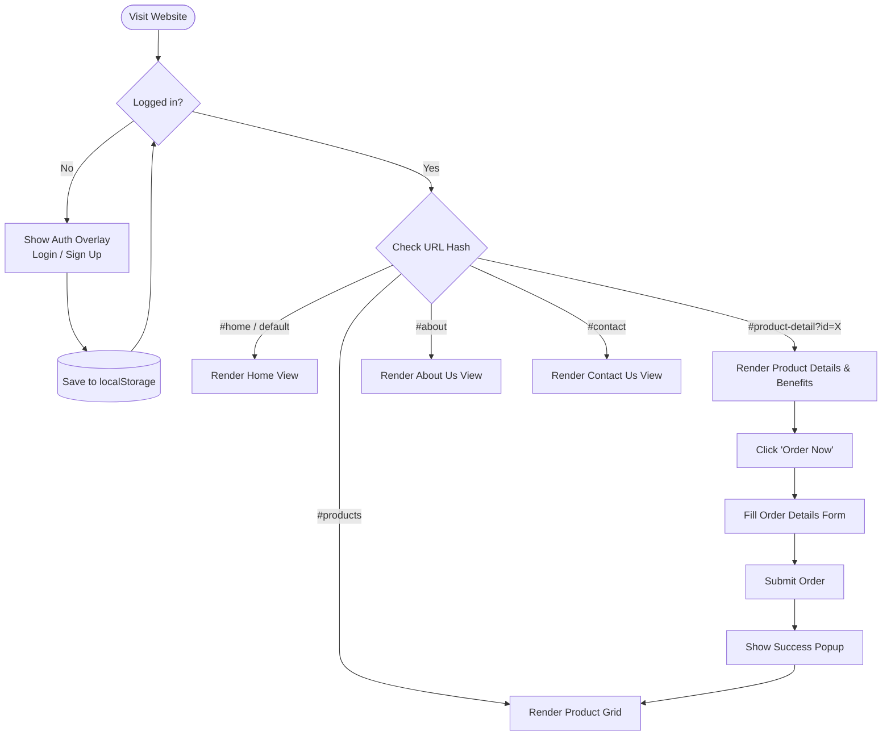

# AgriFlow - Empowering Your Harvest 🌾

[](https://developer.mozilla.org/en-US/docs/Web/HTML)
[](https://developer.mozilla.org/en-US/docs/Web/CSS)
[](https://developer.mozilla.org/en-US/docs/Web/JavaScript)
[](#license)

**AgriFlow** (AgriProducts) is a modern, responsive Single Page Application (SPA) designed to empower farmers and agricultural enthusiasts. The platform provides direct access to high-quality, lab-tested agricultural inputs—such as premium seeds, organic fertilizers, and durable farming tools—at fair and transparent prices.

---

## 📋 Table of Contents

- [Features](#-features)
- [Screenshots & Views](#-views--pages)
- [Tech Stack](#-tech-stack)
- [Project Structure](#-project-structure)
- [Getting Started](#-getting-started)
- [Application Flow & Architecture](#-application-flow--architecture)
- [Demo Credentials / Getting In](#-authentication--access)
- [Future Enhancements](#-future-enhancements)
- [License](#-license)

---

## ✨ Features

- 🔐 **User Authentication System**:
  - Modal authentication gate requiring account creation or login before entering the platform.
  - Client-side credential persistence using browser `localStorage`.
  - Tabbed interface to switch seamlessly between **Login** and **Sign Up**.
  - Form validation with dedicated error prompts.

- 🧭 **Client-Side Hash-Based SPA Routing**:
  - Seamless navigation between pages (`#home`, `#products`, `#product-detail?id=X`, `#about`, `#contact`) without full page reloads.
  - Dynamic route parsing, view toggling, and scroll restoration.
  - Interactive navigation bar with active state tracking and mobile hamburger toggle.

- 🛒 **Dynamic Product Catalog & Details**:
  - Products catalog rendered on demand with categories (Seeds, Fertilizers, Tools).
  - Detailed product view displaying pricing, specifications, key agronomic benefits, and usage instructions.
  - Deep-linkable product URLs via query parameters (e.g., `#product-detail?id=1`).

- 📦 **Interactive Ordering Flow**:
  - Easy "Order Now" modal dialog capturing customer contact details and delivery address.
  - Order confirmation feedback modal with auto-resetting forms.

- 🌿 **Farmer Resources & Guidance**:
  - Featured agricultural categories.
  - Value propositions ("Why Choose AgriFlow": Lab-Tested Quality, Fast Delivery, Fair Pricing).
  - Seasonal farming tips and best practices for crop management.

- 📞 **Contact & Support**:
  - Direct inquiry form with automated feedback.
  - Warehouse location details and embedded map placeholder.

- 📱 **Responsive & Accessible Design**:
  - Mobile-first, fully responsive layout adapting smoothly from mobile screens to desktop monitors.
  - Modern typography using Google Fonts (**Outfit**) and iconography via **Font Awesome 6**.
  - Earthy, nature-inspired custom color palette with smooth CSS transitions and hover states.

---

## 🖥️ Views & Pages

| View | Route | Description |
|------|-------|-------------|
| **Home** | `#home` | Hero banner, category highlights, value proposition cards, and seasonal agricultural tips. |
| **All Products** | `#products` | Dynamic grid listing all available seeds, fertilizers, and farming tools with pricing and quick view actions. |
| **Product Detail** | `#product-detail?id={id}` | In-depth product view featuring key benefits, usage guidelines, and order action. |
| **About Us** | `#about` | Company background, mission statement, and dedication to sustainable agriculture. |
| **Contact Us** | `#contact` | Get in touch form, warehouse address, email contacts, and map placeholder. |

---

## 🛠️ Tech Stack

- **HTML5**: Semantic elements, accessible input forms, modal overlays.
- **CSS3**: Custom design tokens (CSS variables), Flexbox, CSS Grid layouts, media queries, and keyframe animations.
- **JavaScript (Vanilla ES6+)**: DOM manipulation, event listeners, hash router, and `localStorage` state management.
- **Iconography**: [Font Awesome 6](https://fontawesome.com/) via CDN.
- **Typography**: [Google Fonts (Outfit)](https://fonts.google.com/specimen/Outfit).
- **Images**: High-resolution agriculture imagery sourced via Unsplash.

---

## 📂 Project Structure

```text
AgriProducts/
├── index.html        # Main HTML layout, views, templates, and modal overlays
├── styles.css        # Core stylesheet, CSS design system, and responsive breakpoints
├── app.js            # Client-side router, product catalog data, auth logic, and modals
├── FRAMESET3.html    # Legacy HTML frameset reference file
├── my-website.zip    # Archived backup archive of the website assets
├── README.html       # Visual rendered HTML preview of the project documentation
└── README.md         # Comprehensive project documentation
```

---

## 🚀 Getting Started

### Prerequisites

No special package managers or backend runtimes are required. All you need is a modern web browser (Google Chrome, Mozilla Firefox, Microsoft Edge, Safari, etc.).

### Running Locally

1. **Clone the repository**:
   ```bash
   git clone https://github.com/k-heman/AgriProducts.git
   cd AgriProducts
   ```

2. **Open the project**:
   - **Directly in Browser**: Double-click `index.html` or open it with your browser.
   - **Using VS Code Live Server**: Right-click `index.html` and select **"Open with Live Server"**.
   - **Using Python HTTP Server**:
     ```bash
     python -m http.server 3000
     ```
     Then navigate to `http://localhost:3000` in your browser.
   - **Using Node.js `npx serve`**:
     ```bash
     npx serve .
     ```

---

## 🔒 Authentication & Access

When you first launch the website, the **AgriFlow Authentication Overlay** will appear:

1. Click on the **Sign Up** tab.
2. Fill in your desired **Username**, **Email**, **Mobile Number**, and **Password**.
3. Submit the form to automatically register and log in.
4. Your session will be stored in your browser's `localStorage` under `agriflow_currentUser` and `agriflow_users`.
5. On subsequent visits, log in directly using the **Login** tab with your registered credentials.

---

## 🔄 Application Flow & Architecture



---

## 🔮 Future Enhancements

- [ ] Connect to a persistent backend database (e.g., Node.js / Express with PostgreSQL or MongoDB).
- [ ] Add shopping cart functionality with multiple items and quantity adjustments.
- [ ] Implement online payment gateway integration (Stripe, Razorpay, or PayPal).
- [ ] Introduce search and category filter bars on the Products page.
- [ ] Farmer community forum and expert advisory consultation portal.

---

## 📄 License

This project is open source and available under the [MIT License](LICENSE).